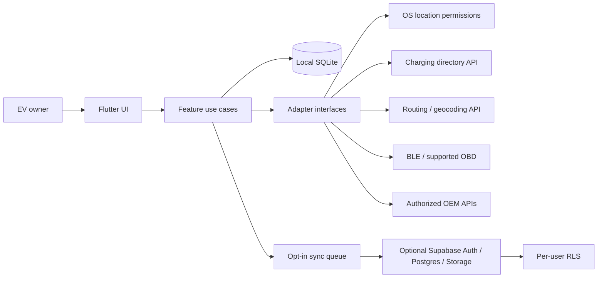

# EV Vehicle Tracker — full-stack architecture (design baseline)

Status: architectural design; not all described features are implemented. [Implementation status](IMPLEMENTATION_STATUS.md) and [TODO](../TODO.md) are authoritative for delivery.

## Goals
- Android and iOS Flutter app; lightweight minimalist light-green UI; both electric cars and scooters.
- Offline-first, no account required, SQLite as canonical local store, user-controlled backup.
- Optional Supabase cloud sync, not a dependency for basic functionality.
- No unauthorized vehicle control, scraped OEM credentials, fabricated SOC/health/charger status.
- Open source, maintainers approve PRs and releases; app-store publication postponed.

## System context


## Frontend information architecture
| Tab | Screen | Real user workflows | Data source |
|---|---|---|---|
| Home | Overview | Select vehicle, SOC/range if known, quick add charge/trip, upcoming service, costs | Local aggregates + timestamped telemetry |
| Garage | Fleet | Add/edit/archive, battery/plug profile, odometer, ownership documents, model capabilities | SQLite |
| Charge | Charging | Session CRUD, energy cost, nearby map/list, connector filters, favourites, availability freshness | SQLite + opt-in station provider |
| Trips | Planner | Manual trip logs, prompt parse + confirmation, SOC reserve, route, compatible chargers and alternates | SQLite + opt-in routing |
| More | Health, insights, settings | Fault cases, warranty, finance, analytics, backup, connectivity, privacy | SQLite + opt-in adapters |

### Supporting flows
Onboarding (no login), vehicle setup, notification permission, manual-location fallback, charger detail, trip review, issue detail, service timeline, export/import preview, provider connection/consent, optional cloud sign-in, conflict review, accessibility and data deletion.

### Visual tokens
Primary #0AAF47, dark green #087C39, background #F3FAF7, ink #10241B, secondary #52675C; white cards, 16–22px radius, 8pt spacing, large tap targets. Dark theme optional; no false live status.

## Code layering
```text
lib/
  app/                    # app bootstrap, navigation, dependency injection
  core/
    database/             # SQLite migration and transactions
    errors/               # typed failure/result
    privacy/              # consent and permissions
    networking/           # timeouts, rate limits, caching
    sync/                 # optional queue and conflict resolution
  domain/
    vehicle.dart          # existing
    ownership_record.dart # existing generic record
    energy_estimator.dart # existing
    trip_prompt.dart      # existing
    charging_station.dart # existing
  features/
    dashboard/
    garage/
    charging/
    trips/
    vehicle_health/
    finance/
    analytics/
    connectivity/
    settings/
  integrations/
    charging/             # OCM provider with attribution and cache
    maps/                 # OSM tiles, geocoder and route adapter
    bluetooth/            # explicit opt-in and model capability checks
    obd/                  # read-only supported vehicle profiles
    oem/                  # official API clients only
    cloud/                # optional Supabase client
  ui/                     # theme and shared widgets
```
Each feature should have presentation (widgets + state), application (use cases), domain (entities + policies), and data (repository implementations). Dependency direction: presentation -> application -> domain; data implements domain interfaces. Avoid direct plugin calls from widgets.

## Data architecture
Local SQLite tables (incremental migrations, indexed foreign keys, UTC timestamps, explicit currency): vehicles, vehicle_capabilities, odometer_events, charging_sessions, trips, trip_waypoints, expenses, loan_accounts, loan_payments, service_cases, service_events, warranties, documents, reminders, telemetry_observations, charging_station_cache, charger_reports_drafts, sync_outbox, sync_state.

Use integer minor units for money; store measured energy in Wh or decimal kWh with explicit precision; store distance in metres or decimal km consistently; keep source, confidence and observed_at on telemetry. Separate manually entered SOC from connected SOC. Avoid personally identifying location data in logs.

## Optional backend boundary
- Cloud sync uses Supabase Auth (opt-in), Postgres with per-user RLS, private Storage buckets for documents, Edge Functions for provider proxies or moderation when justified.
- No user account, login or backend is required to use core garage, records, expenses or offline estimates.
- Sync is an asynchronous outbox with stable UUIDs, idempotent upserts, tombstones, server timestamps, version checks, retry/backoff, and explicit conflict UI. Never silently overwrite financial records.
- Cloud sync does not grant vehicle-control capability. Never expose secret/service-role keys in the mobile app.
- Community reports are a separate opt-in, moderated and privacy-reviewed feature. Public display never includes raw user IDs, VIN, plates, exact home addresses or private routes.

## Provider contracts
ChargingStationProvider.nearby -> typed stations with connector, source and verification timestamp; unknown availability is not available. RoutingProvider.route -> route geometry, legs, distance, duration and provenance; GeocodingProvider.search -> user-confirmed location; VehicleDataProvider.capabilities/readSnapshot -> permitted read-only fields, source, observed_at and errors. Any provider can be unavailable without breaking local workflows.

## Security, reliability, compliance
Threat model: device theft, leaked backups, malicious PRs, compromised provider credentials, unauthorized telemetry, cross-account cloud access, location privacy, stale charger data, sync conflicts. Use OS keystore for secrets, TLS, minimum permissions, no remote control by default, RLS tests, least-privilege CI, dependency/secret scanning, signed releases and SBOM later. Explicit consent for GPS, Bluetooth, push and cloud. Avoid putting unverified vehicle-health scores in UI.

## Nonfunctional acceptance
- Cold start and navigation budgets measured on low-end Android hardware.
- Offline CRUD survives process death; migrations/restore are tested.
- No mandatory cloud calls on app launch.
- WCAG-oriented contrast, text scaling, keyboard/screen-reader focus, ≥48dp targets.
- Network failures do not block local functionality.
- Tests: domain unit, repository integration, widget/golden, Android instrumentation, iOS smoke, provider contract, RLS cross-user denial, backup/restore, privacy and performance.
- Publish no store build without explicit owner approval.

## Architecture decisions
ADR-001: Flutter shared frontend.
ADR-002: SQLite canonical offline store.
ADR-003: Supabase optional cloud backend, not a mandatory account.
ADR-004: Read-only vehicle connectivity by default.
ADR-005: No speculative charging availability or battery health.
ADR-006: Owner-reviewed changes and explicit release approval.
